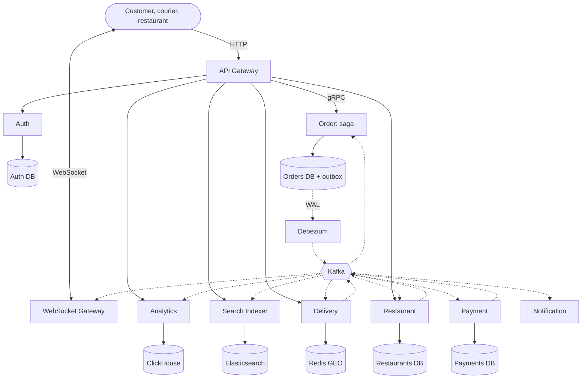
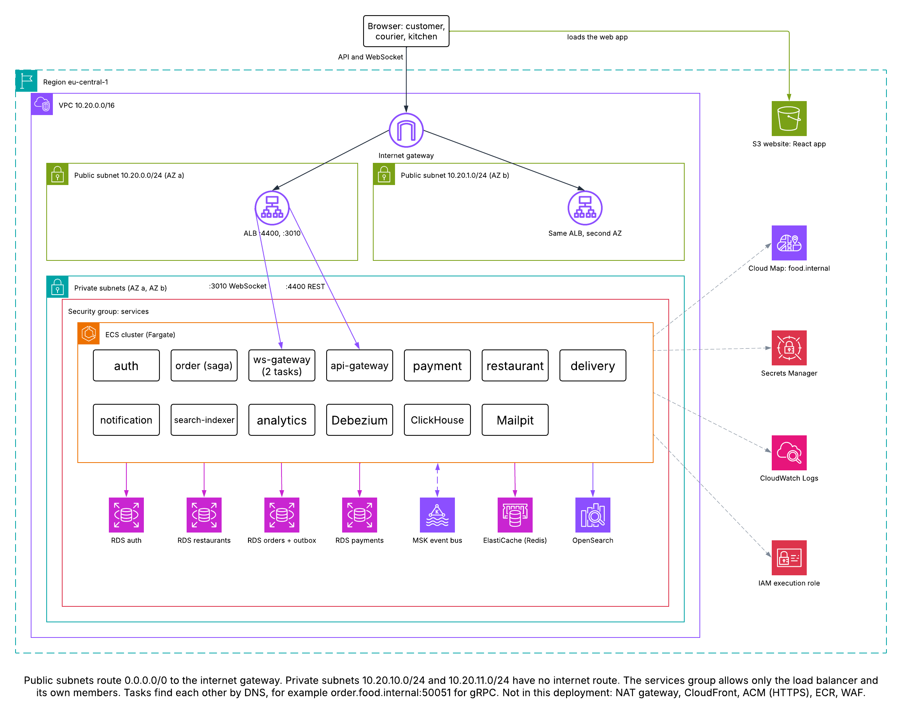

# Food delivery microservices

A runnable NestJS and React system for learning how microservices fit together. An order travels through a gateway, gRPC, a transactional outbox, Debezium, Kafka, an orchestrated saga, Redis GEO and WebSockets, and you can watch each step live.

To learn the patterns, follow [docs/LESSON_PLAN.md](docs/LESSON_PLAN.md).

## Architecture



Solid lines are synchronous and dashed lines are asynchronous. This matches the original diagram, plus the paths the app needs that the diagram leaves out: an Auth DB, and gateway routes to Delivery, Search and Analytics.

## Run it

Needs Node 22+, pnpm 10 and Docker with about 6 GB of memory.

```bash
pnpm install
pnpm infra:up      # Postgres, Kafka, Debezium, Redis, Elasticsearch, ClickHouse, Mailpit
pnpm bootstrap     # JWT keys, DB tables, Kafka topics, Debezium connector
pnpm dev           # all services and the web app
```

Open http://localhost:5173. Use one browser profile or private window per role, because a session is stored per browser profile. All demo accounts use the password `demo1234`, and the sign-in screen has a button for each.

### Follow one order

1. Sign in as **Courier** and press **Go online**. With no courier online, an accepted order is refunded on purpose.
2. Sign in as **Customer** in another window and place an order at Forno Kyiv.
3. Sign in as **Forno Kyiv kitchen** and press **Accept**, then **Mark ready**.
4. As the courier, press **Picked up**, then **Delivered**.

The customer's saga ledger updates live. **Event stream** shows every Kafka event as it happens. To see compensation, tick **Simulate a declined card** or press **Reject**.

## Deploy to a local AWS

To deploy with Terraform to Floci, a local AWS emulator, see [infra/terraform/README.md](infra/terraform/README.md).



## Load experiments

k6 experiments that measure failure isolation, spikes, scaling and the cost of this design, with recorded results: see [load/README.md](load/README.md).

## Where to look

| What | URL |
|---|---|
| Web app | http://localhost:5173 |
| API Gateway | http://localhost:4400 |
| WebSocket Gateway | http://localhost:3010 |
| Kafka UI: topics, consumer groups, DLQs, connector | http://localhost:8088 |
| Mailpit: emails sent to customers | http://localhost:8025 |
| Debezium Connect REST API | http://localhost:8083/connectors |
| Elasticsearch | http://localhost:9200/restaurants/_search |
| ClickHouse HTTP | http://localhost:8123/play |

## Commands

| Command | Does |
|---|---|
| `pnpm test` | Unit tests: saga state machine, retry and DLQ |
| `pnpm e2e` | End-to-end checks against the running stack |
| `pnpm chaos` | Stops Debezium, freezes Payment and floods login, then shows recovery |
| `pnpm typecheck` | Type-checks every package |
| `pnpm infra:down` | Stops the containers and keeps their data |
| `pnpm infra:reset` | Stops the containers and deletes their data. Run `pnpm infra:up` and `pnpm bootstrap` afterwards |

`pnpm e2e` leaves open tickets on the Forno Kyiv board. They close when their saga deadline passes, within 5 minutes.

## Project layout

```
apps/      api-gateway, ws-gateway, auth, order, payment, restaurant,
           delivery, notification, search-indexer, analytics, web
libs/      contracts (event catalogue, config), kafka (bus, retry, DLQ),
           observability (logging, correlation IDs)
proto/     gRPC contract between the gateway and Order Service
infra/     Docker Compose, Debezium connector, database setup
scripts/   bootstrap, e2e, chaos
docs/      lesson plan
```

Services run TypeScript directly through `@swc-node/register`, so `pnpm dev` has no build step and restarts a service when its files change.

## Known limits

This is for local learning, not production:

- Payments and push notifications are simulated. Emails go to Mailpit.
- There is no TLS, and internal service ports are open on localhost, so a local client could bypass the gateway.
- Kafka is a single broker with no replication.
- JWTs last 8 hours with no refresh token or revocation.
- Payment, Restaurant and Delivery publish directly to Kafka, as in the original diagram, so they can lose an event in a crash. The lesson plan covers this and has you fix one.
- Prisma uses `db push` rather than migration files.
- Containerised services (`docker compose --profile apps up --build`, from `infra/`) are provided but not verified. Run `pnpm bootstrap` first, on the host.
