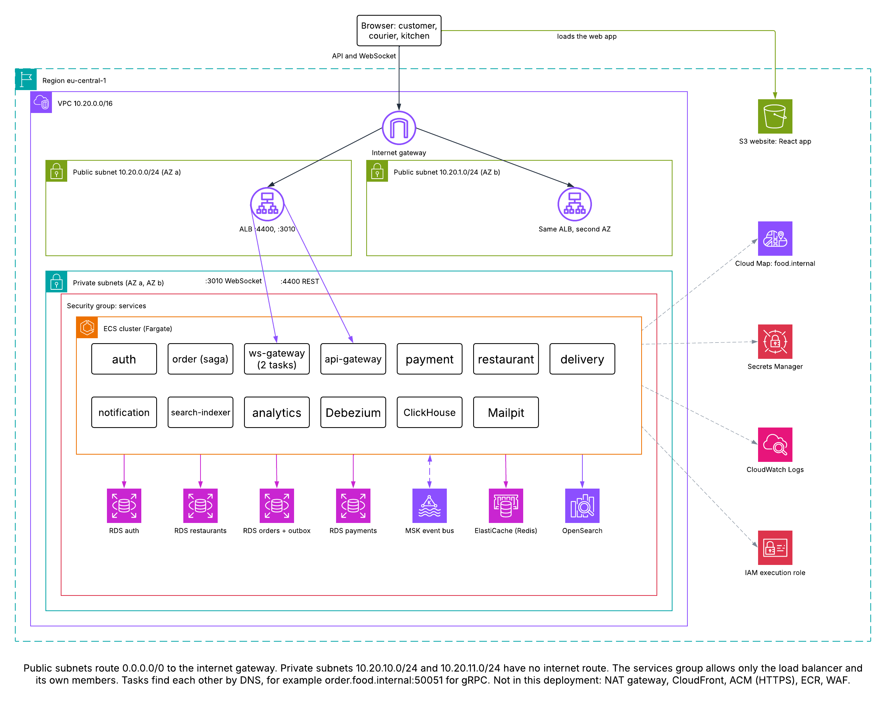
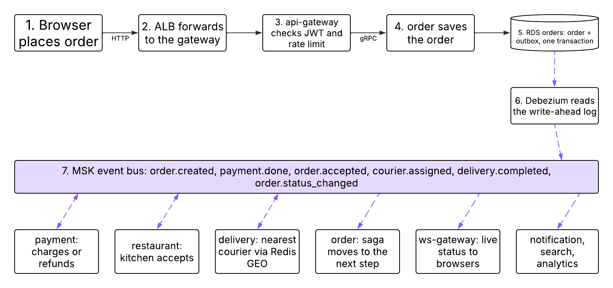
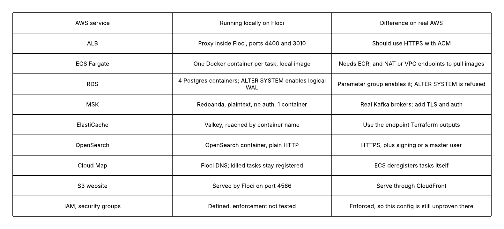

# Deploy to a local AWS with Terraform and Floci

Deploys the whole app with Terraform to [Floci](https://github.com/floci-io/floci), a local AWS emulator. No AWS account or real credentials are involved. Floci starts real containers behind most of these services.

```bash
pnpm infra:down    # the app's Compose stack, if it is running
pnpm aws:deploy    # about 11 minutes from nothing, 10 of it waiting on OpenSearch
pnpm aws:destroy   # about 30 minutes, about 10 of it waiting on OpenSearch
pnpm floci:down    # stop the emulator
```

| What | Where |
|---|---|
| Web app | http://food-delivery-local-web.s3-website-eu-central-1.localhost:4566/ |
| API (through the ALB) | http://localhost:4400 |
| WebSocket Gateway (through the ALB) | http://localhost:3010 |
| Floci console | http://localhost:4566/_floci/ui |

Run the end-to-end checks against the deployment with `KAFKA_BROKERS=localhost:9300 pnpm e2e`. For load tests, see [load/README.md](../../load/README.md).

Keep the laptop awake during a deploy or destroy: a sleep can leave Terraform stuck, holding its lock.

Do not run `pnpm dev` at the same time: it uses the same ports. Stop the deployment with `pnpm floci:down` first.

## Architecture



How one order moves through it:



What differs between this local deployment and real AWS:



Editable source: [Lucidchart document](https://lucid.app/lucidchart/9fa0375a-c2e4-42a7-963d-c376e06fca8e/edit). It opens only for people it is shared with, so the images above are what visitors see.

## What runs where

| App part | AWS service | What Floci actually runs |
|---|---|---|
| React app | S3 website | Files in Floci |
| Gateways | ALB | A proxy inside Floci |
| 10 NestJS services | ECS Fargate | One container per task, 2 for ws-gateway |
| Service discovery | Cloud Map | Floci's DNS |
| 4 databases | RDS | 4 Postgres containers |
| Kafka | MSK | Redpanda, a Kafka-compatible broker |
| Redis | ElastiCache | Valkey |
| Search | OpenSearch | OpenSearch |
| Secrets | Secrets Manager | Stored in Floci, injected into tasks |
| Debezium, ClickHouse, Mailpit | ECS Fargate | Plain containers |

## Deploy order

`deploy-local.sh` creates the data services first, then sets up logical replication, tables, topics and the Debezium connector, and only then starts the services. `destroy-local.sh` removes services first, because Cloud Map refuses to delete a service with registered instances. It also clears registrations left by tasks killed outside ECS, which Floci does not clean up.

## Floci-only workarounds

These would have to change for real AWS:

- **Logical replication:** Floci stores `rds.logical_replication` but does not apply it, so the script runs `ALTER SYSTEM`. Real RDS applies the parameter and refuses `ALTER SYSTEM`.
- **Redis URL:** Floci reports `localhost`, so tasks use its container name. Use `module.data.redis_url` on real AWS.
- **Search URL:** Floci's endpoint includes `http://`. A real endpoint needs `https://` added, and usually request signing or a master user.
- **Service image:** tasks use a locally built image. ECR repositories are not defined; real AWS needs them, and a CI step to push.
- **Kafka:** plaintext with no authentication.

## Other limits

- `terraform plan` always shows one change to the database parameter group, because Floci does not return that parameter when read back. It is harmless, and applying it changes nothing.

- A passing deploy shows the app runs on Floci. It does not prove it will run on real AWS, where IAM, security groups and networking are enforced differently.
- There is no HTTPS. CloudFront, ACM and Route 53 are not used.
- Services run TypeScript directly rather than a compiled build.
- Floci holds the Docker socket, so it has full control of your Docker daemon. Its API and the gateways are limited to your machine, but Floci publishes the Kafka port 9300 on all interfaces.
- Terraform state holds passwords and the JWT private key in plain text. It is ignored by git.
- This stack uses about 4 GB of Docker memory.
